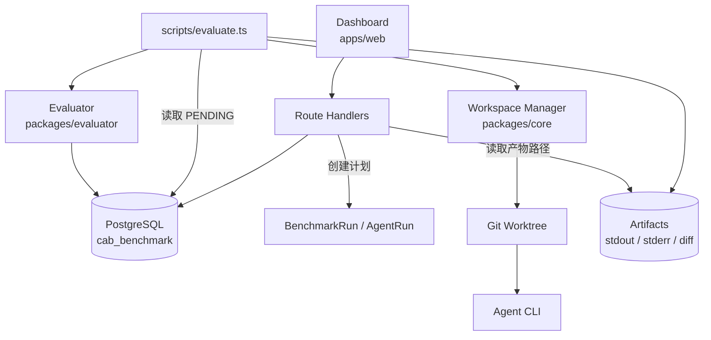
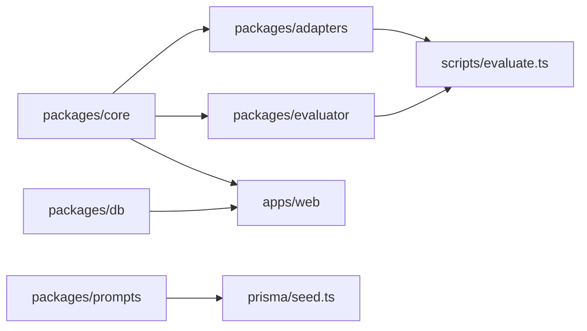
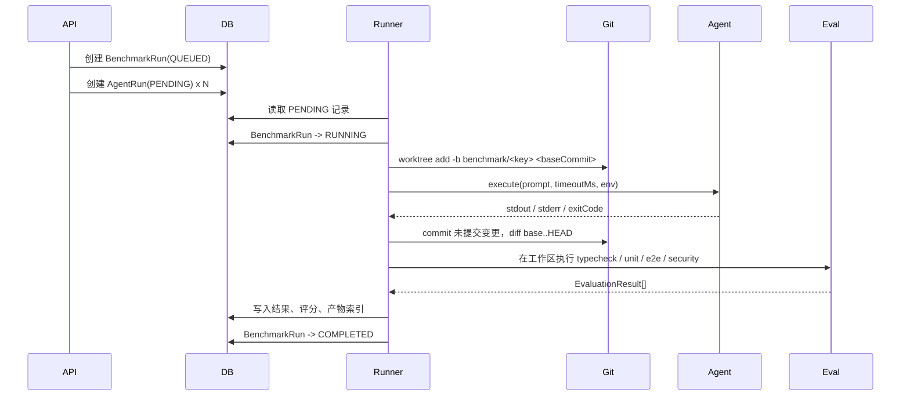
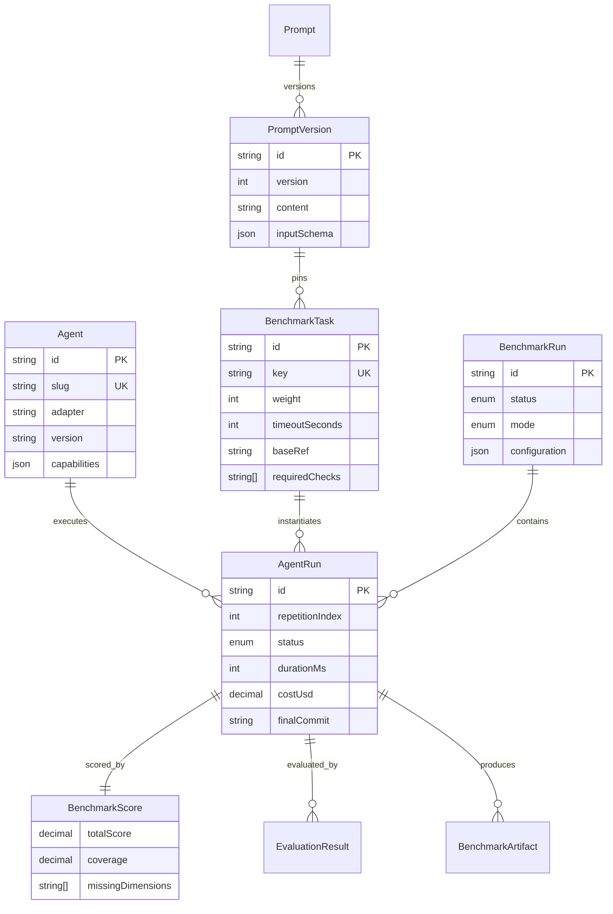
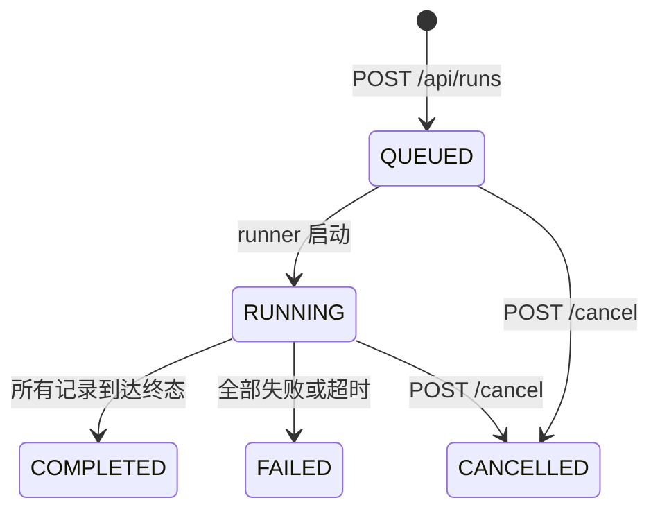

# 架构

## 控制平面与执行平面

控制平面不执行 Agent。评测批次创建后只是数据库中的执行矩阵，`scripts/evaluate.ts` 作为独立进程消费这些记录。这样 HTTP 请求不会持有长进程，Runner 崩溃也不会破坏控制平面。

## 包依赖

`core` 只依赖 Node 内置模块，不依赖 Prisma。数据库类型只出现在 `packages/db` 和 `apps/web`，避免执行层被控制平面的持久化细节污染。

## 一次运行的时序

## 关键实现位置

| 能力 | 文件 |
|---|---|
| Agent 契约 | `packages/core/src/types/agent.ts` |
| 执行计划矩阵 | `packages/core/src/types/run.ts` |
| 进程与超时终止 | `packages/core/src/lib/exec.ts` |
| Worktree 与 Diff | `packages/core/src/workspace/git.ts` |
| 单任务执行与产物落盘 | `packages/core/src/task-engine/execute.ts` |
| 评分 | `packages/core/src/types/scoring.ts` |
| 验收检查 | `packages/evaluator/src/checks.ts` |
| 评分映射 | `packages/evaluator/src/scoring.ts` |
| 批次执行循环 | `scripts/evaluate.ts` |

## 数据模型

`AgentRun` 的唯一键是 `(benchmarkRunId, agentId, taskId, repetitionIndex)`，重复实验不会互相覆盖。`PromptVersion` 由任务固定；修改 Prompt 必须产生新版本，否则历史批次无法解释。

## 状态机

Agent 运行记录独立维护 `PENDING -> RUNNING -> COMPLETED | FAILED | TIMEOUT | CANCELLED`。Runner 在每条记录开始前重新读取批次状态，并在执行期间每 5 秒轮询取消信号。
